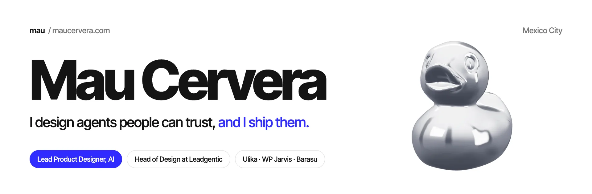
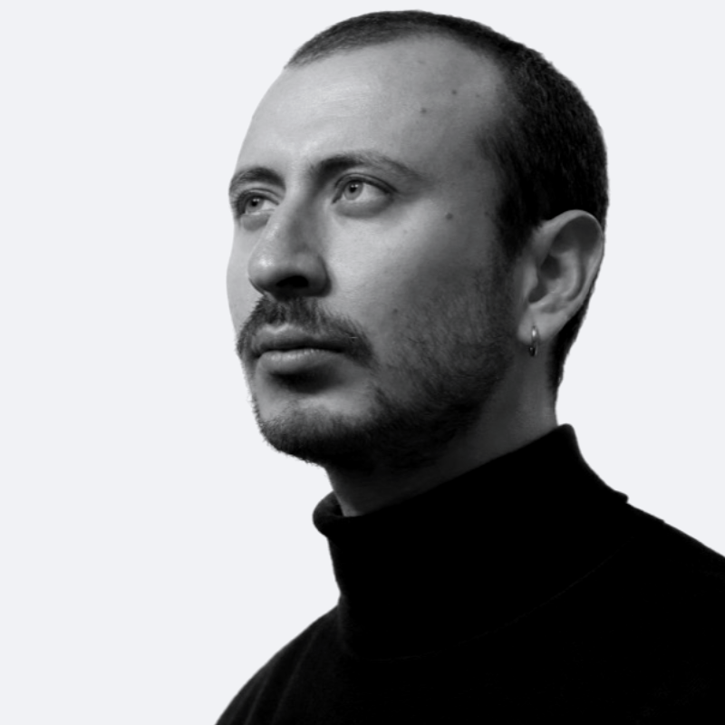
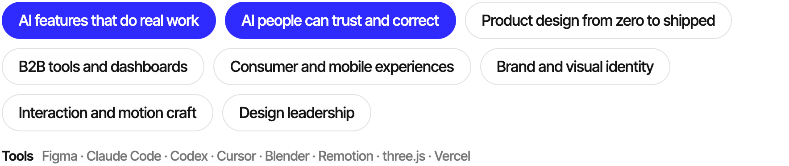
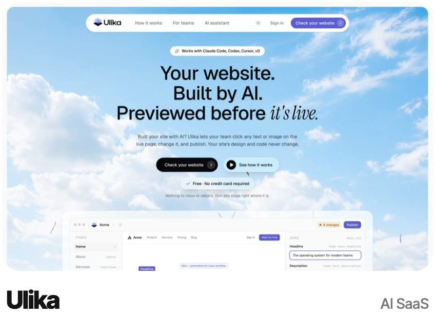
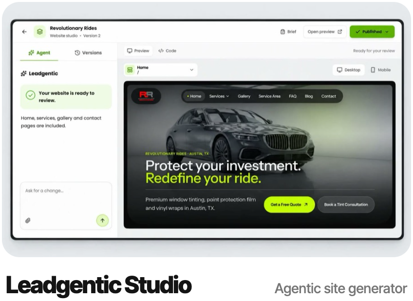
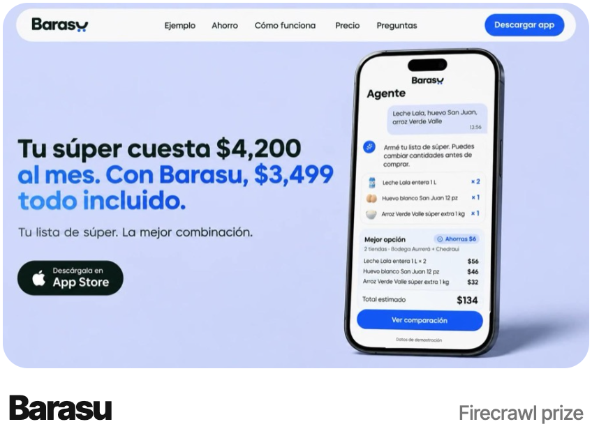
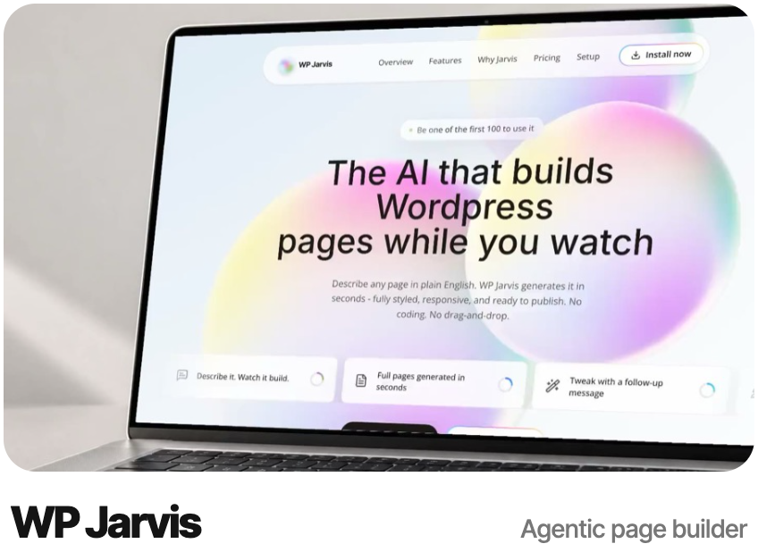
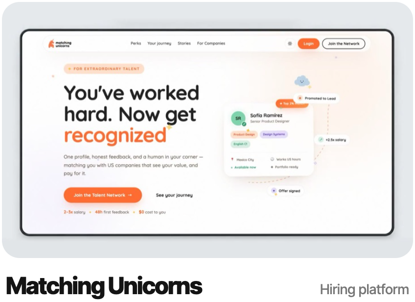
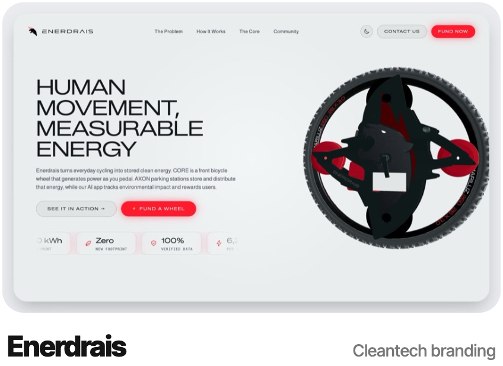

<a href="https://www.maucervera.com">
  <picture>
    <source media="(prefers-color-scheme: dark)" srcset="assets/banner-dark.webp">
    
  </picture>
</a>

  <a href="https://www.maucervera.com"><picture><source media="(prefers-color-scheme: dark)" srcset="assets/pill-portfolio-dark.png"></picture></a>
  <a href="https://linkedin.com/in/mau-cervera"><picture><source media="(prefers-color-scheme: dark)" srcset="assets/pill-linkedin-dark.png"></picture></a>
  <a href="https://www.instagram.com/maucervera17/"><picture><source media="(prefers-color-scheme: dark)" srcset="assets/pill-instagram-dark.png"></picture></a>
  <a href="mailto:maucervera17@gmail.com"><picture><source media="(prefers-color-scheme: dark)" srcset="assets/pill-email-dark.png"></picture></a>
  <a href="https://calendly.com/ulika/ulika-intro-with-mau"><picture><source media="(prefers-color-scheme: dark)" srcset="assets/pill-call-dark.png"></picture></a>

 

<picture><source media="(prefers-color-scheme: dark)" srcset="assets/title-about-dark.png"></picture>

I'm Mau, a product designer working across AI products, agentic systems and digital experiences.

I go from what people need to what the agent does, connecting human intent, product behavior and the systems underneath.

Nine years designing digital products, from Apple to my own studio. Now Head of Design at Leadgentic, where I turned the design team into an AI-first team.

I ship my own AI products end to end, like Ulika and WP Jarvis.

My dog is called Pato, it's Spanish for duck. Off the clock I make music as Luvo Laska.

 
 

<picture><source media="(prefers-color-scheme: dark)" srcset="assets/title-what-i-do-dark.png"></picture>

<picture><source media="(prefers-color-scheme: dark)" srcset="assets/chips-what-i-do-dark.png"></picture>

 

<picture><source media="(prefers-color-scheme: dark)" srcset="assets/title-work-dark.png"></picture>

  <a href="https://www.maucervera.com/work/ulika.html"><picture><source media="(prefers-color-scheme: dark)" srcset="assets/card-ulika-dark.png"></picture></a>
  <a href="https://www.maucervera.com/work/leadgentic-studio.html"><picture><source media="(prefers-color-scheme: dark)" srcset="assets/card-leadgentic-studio-dark.png"></picture></a>
  <a href="https://www.maucervera.com/work/barasu.html"><picture><source media="(prefers-color-scheme: dark)" srcset="assets/card-barasu-dark.png"></picture></a>
  <a href="https://www.maucervera.com/work/wp-jarvis.html"><picture><source media="(prefers-color-scheme: dark)" srcset="assets/card-wp-jarvis-dark.png"></picture></a>
  <a href="https://www.maucervera.com/work/matching-unicorns.html"><picture><source media="(prefers-color-scheme: dark)" srcset="assets/card-matching-unicorns-dark.png"></picture></a>
  <a href="https://www.maucervera.com/work/enerdrais.html"><picture><source media="(prefers-color-scheme: dark)" srcset="assets/card-enerdrais-dark.png"></picture></a>

 

<picture><source media="(prefers-color-scheme: dark)" srcset="assets/title-open-source-dark.png"></picture>

**[open-dtc-portal](https://github.com/maucervera17/open-dtc-portal)** · A self-hosted performance portal for direct-to-consumer brands. Meta Ads and sales analytics, an AI analyst, and competitor ad intelligence, inspired by tools such as Atria.

**[wp-jarvis-connector](https://github.com/maucervera17/wp-jarvis-connector)** · The lightweight WordPress plugin that connects any WordPress site to WP Jarvis, the AI page builder.

 

<picture><source media="(prefers-color-scheme: dark)" srcset="assets/title-activity-dark.png"></picture>

<picture>
  <source media="(prefers-color-scheme: dark)" srcset="https://raw.githubusercontent.com/maucervera17/maucervera17/output/contributions-dark.svg">
  
</picture>
